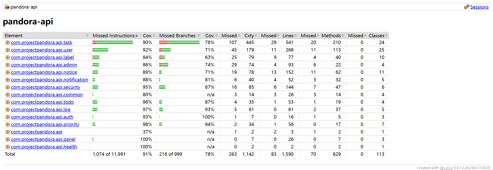

# 潘多拉项目中期测试报告

软件开发与测试综合实训 · 2026年11月20日

本报告依据《中期验收要求.pdf》，对修复后的潘多拉项目开展后端核心业务测试。最终全量288条自动测试全部通过；其中本轮新增120条验收用例，对应40个核心业务写入方法，每个方法均有正常、边界或状态边界、异常三类用例。行覆盖率94.78%，分支覆盖率78.38%。

本版为自动测试和文档整理完成版。人工实测只记录已明确反馈的场景；课程要求的学生逐条用例复核尚待签认。报告不作项目完全无缺陷或全部部署环境均验证通过的结论。

## 一 验收依据与交付对应

| 文件要求 | 本轮对应材料 |
|---|---|
| 关注后端核心业务，每个核心方法至少3条用例 | 附件01，40个方法、120条独立用例 |
| 覆盖正常、边界、异常输入 | N、B、X编号及设计说明；B含状态边界 |
| 等价类划分与边界值分析 | 本报告第二部分及附件01 |
| 测试过程、用例设计、测试结论 | 本报告及附件02、05 |
| AI用例需人工逐条修改或复核，附提示词 | 附件04真实输入与生成约束；CSV待学生签认 |
| 建议附框架覆盖率输出截图 | 第四部分截图及证据/jacoco完整报告 |
| 验收前放入小组共享文件夹 | 文件已在仓库整理；上传共享文件夹需由小组完成 |

JUnit与pytest属于建议框架，不要求同时使用；本项目使用JUnit。要求没有规定覆盖率最低比例、页数或Word格式。现场验收每组20至30分钟，第10周内开展。

## 二 版本与测试环境

| 项目 | 实际环境 |
|---|---|
| 生产源码基线 | main `c0982b07be8a`；完整提交号见执行元数据 |
| 本轮新增内容 | 验收测试、用例目录、执行脚本与文档；未修改业务逻辑 |
| 平台与Java | Windows；Oracle JDK21.0.6；按Java17目标编译 |
| 后端 | Spring Boot3.3.4、Maven3.9.10、JUnit Jupiter5.10.3、MockMvc |
| 数据库 | H2 2.2.224内存库，启用Flyway，测试配置test |
| 覆盖率 | JaCoCo0.8.12，统计本轮全量测试 |
| Web | Node24.14.0、Vue3.5.22、Vite6.1.0 |
| Android对应源码 | 0.10.12，code75；用户实测设备及安装版本未提供 |

## 三 测试范围与用例设计

选取40个需要业务校验、权限控制或状态变化的后端写入方法作为本次核心清单。查询权限、组织访问、历史迁移和并发行为由既有测试继续覆盖。实体getter、响应映射、框架生成方法等没有作为独立核心业务函数凑数；核心入口的私有校验逻辑通过入口测试间接执行。

| 业务模块 | 核心方法与用例范围 |
|---|---|
| 登录 | A01：登录及停用、错误密码 |
| 任务与审批 | A02至A15：创建、批量、改期、初审、进度、内容变更、撤回、批准、驳回、删除、关键词、通用审核、私密备注 |
| 日志 | A16至A18：创建、修改、提交 |
| 私人事项 | A19至A21：创建、更新合并、删除 |
| 公司事项与个人清单 | A22至A25：发布、修改、私密备注、清单整体保存 |
| 标签 | A26至A29：创建、修改、停用、内容标签独立保存 |
| 资料与账号 | A30至A36：个人资料、两套密码和头像接口、管理员创建与修改账号 |
| 查看申请与通知 | A37至A40：申请、审批、单条与全部已读 |

### 等价类划分

按有效与无效长度、允许与不允许日期、正确与错误身份、合法与非法状态分别划分输入。成功操作断言内容或数据库状态；拒绝操作断言400、403、404或409等预期结果。拒绝无效输入属于用例通过，不能算业务失败。

### 边界值与状态边界

| 规则 | 本轮独立用例中的取值 | 预期 |
|---|---|---|
| 任务时间区间 | 开始早于、等于、晚于截止 | 前两者允许，倒置拒绝 |
| 进度百分比 | 50、100、101 | 正常值与上限允许，越上限拒绝 |
| 日志可创建日期 | 今天、前天、三天前 | 今天与前天允许，三天前拒绝 |
| 日志编辑时限 | 24小时内、24小时1秒后 | 允许与拒绝；更细时间场景见既有LogWriteWindowTests |
| 私人事项标题 | 普通文本、200字、201字 | 上限允许，越界拒绝 |
| 启用公司事项 | 0条后创建、9条后创建、10条后创建 | 第10条允许，第11条拒绝 |
| 标签数量 | 1、12、13 | 1至12允许，13拒绝 |
| 业务状态转换 | 待审到批准、批准后重复、他人自审 | 正常转换、重复拒绝、越权拒绝 |

完整输入和120条执行记录见附件01。状态边界不等同于数值边界，两种设计均在表中明确标识。批量100人上限、所有时间精确临界点及全部字段组合没有穷举，不以3条用例代表分支全覆盖。

## 四 测试执行与结果

先同步main并核对修复代码，再整理用例与预期，执行新增用例，修正测试自身的前置数据和事务刷新问题，最后清理历史target并对全部后端测试重新执行。最终结果完成于2026年11月20日12时10分45秒，北京时间；报告仅采用这一轮输出。

| 验证项目 | 执行结果 | 证据 |
|---|---|---|
| 后端全量测试 | 288条，失败0、错误0、跳过0 | 30份本轮JUnit XML及执行日志 |
| 其中新增核心验收用例 | 120条，40个核心方法均3/3通过 | MIDTERM_CASE编号与附件01对应 |
| 原有后端测试 | 168条通过，含权限、迁移、并发等 | 附件05逐类统计 |
| Web状态测试 | 18条通过 | Web测试.txt |
| Web生产构建 | 成功 | Web构建.txt |

### 全体生产代码覆盖率

| 指标 | 已覆盖／总数 | 比例 |
|---|---|---|
| 行 | 1507／1590 | 94.78% |
| 分支 | 783／999 | 78.38% |
| 方法 | 559／629 | 88.87% |

统计对象包含后端生产实体、控制器、服务、记录类型与启动配置，没有排除低覆盖类。方法计数629包含辅助方法及生成代码，并不表示项目有629个核心业务功能。报告按XML精确计数保留两位小数；JaCoCo HTML界面可能显示整数百分比。

| 核心类 | 行覆盖 | 分支覆盖 |
|---|---|---|
| TaskService | 94.57% | 76.92% |
| WorkLogController | 100.00% | 93.18% |
| PersonalTodoController | 98.00% | 87.50% |
| CompanyNoticeService | 91.67% | 71.88% |
| PersonalPriorityService | 97.78% | 94.12% |
| ContentLabelsController | 77.42% | 52.63% |
| AdminUserController | 95.29% | 74.04% |

目前分支未覆盖216个。覆盖率只能说明测试执行经过的代码，不能代替需求覆盖、真机体验或真实数据库的并发验证。完整HTML可离线打开。

## 五 覆盖率输出截图

下图直接截取本轮JaCoCo HTML报告首页，未重绘数值。截图为建议附加证据，原始HTML、XML、CSV和执行数据文件随包保存。

## 六 缺陷修复与人工回归

队友已提交原13项问题的修复。本轮对日志旧版本冲突、事项不同字段合并与同字段冲突、重复创建幂等、旧任务补开始时间、逾期文字修改、日期清空、公司事项并发上限、多标签权限和旧电话兼容等进行了自动回归。具体测试名和证据层级见附件02，不将源码已改动直接等同于端到端验收通过。

用户已反馈查看另一篇日志不覆盖草稿；切换任务编辑有放弃选项；创始人可以修改无待审申请的逾期任务。此前“不能修改”的反馈已由用户更正，不作为遗留缺陷。任务草稿取消后恢复、双端界面冲突、拖动中断、通知A返回后打开B等剩余人工操作，仍按附件03记录实际结果。

本轮尝试在专用目录启动本机独立MySQL实例，但安装缺少组件，未成功启动；未连接既有业务数据库，也没有据此声称迁移存在新故障。MySQL首次安装与Docker整套启动仍需服务器负责人验证。历史验收文档中的旧运行结果仅作参考，没有计入本轮测试数量。

## 七 测试结论与提交条件

在本报告记录的代码版本、H2测试环境和输入范围内，后端288条自动测试全部通过，40个核心业务写入方法均具备至少三条独立验收用例，并使用等价类划分与边界值分析。Web18条测试及构建通过。本轮没有在最终全量执行中发现自动测试失败。

这些结果支持中期验收中的后端测试展示，不代表所有环境、设备和需求组合均无缺陷。人工反馈未涉及的操作、MySQL和Docker运行环境、Android重新构建，均不计为本轮已通过。用户设备与线上部署版本尚未核对，不能把线上手工反馈自动归为本地同一提交的实测。

### 提交前仍需小组完成

1. 按附件01 CSV逐条人工复核AI生成用例，填写真实复核人、日期与意见；如修改用例，重新执行并更新报告。
2. 补充附件03中的实际设备版本、执行人和人工结果；未执行项保留明确状态。
3. 将报告和附件放到小组共享文件夹。当前只完成仓库内文件整理，不声称已上传共享文件夹。

### 现场验收建议安排

20至30分钟可安排为：3分钟介绍业务与测试范围，6分钟展示等价类和边界值设计，5分钟运行或讲解JUnit结果及覆盖率，5至8分钟演示修复回归与权限差异，最后留答疑时间。此安排是准备建议，不是PDF另行规定的交付物。

## 八 文件与复现

- 附件01：核心方法对应表、120条用例及CSV人工签认字段。
- 附件02：13项缺陷修复与回归记录。
- 附件03：人工验证记录。
- 附件04：真实AI提示词、生成约束、修正过程及人工复核状态。
- 附件05：30个测试类逐项统计与覆盖率说明。
- 证据：JUnit XML、JaCoCo完整HTML/XML/CSV、执行数据、截图及本轮日志。
- 测试源码：本轮新增Java测试、JSON用例目录及重跑脚本快照。

在仓库使用scripts/Run-MidtermTests.ps1并提供Maven与Java路径可重新生成证据。重跑会清理后端target测试产物，使用H2测试配置，不连接真实服务器。新一轮证据生成后，需重新同步书面结果，不能沿用旧报告数值。

验收依据为用户提供的一页《中期验收要求.pdf》。原始需求、项目规则和缺陷清单分别参见仓库docs中的产品设计、团队分工及2026年11月19日全项目问题检查文档。报告结论以本轮真实执行与用户最终确认的信息为准。
