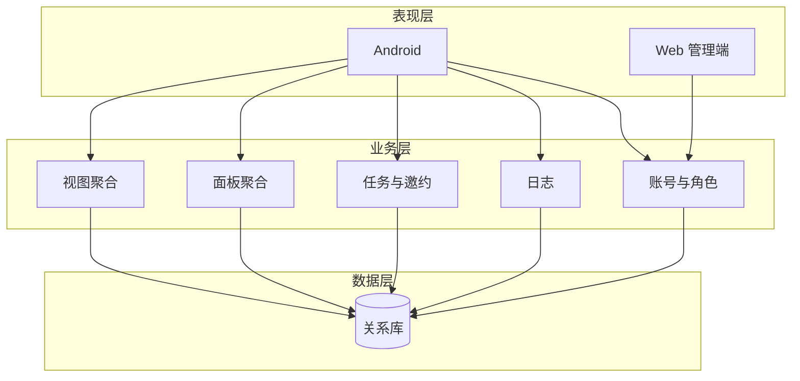
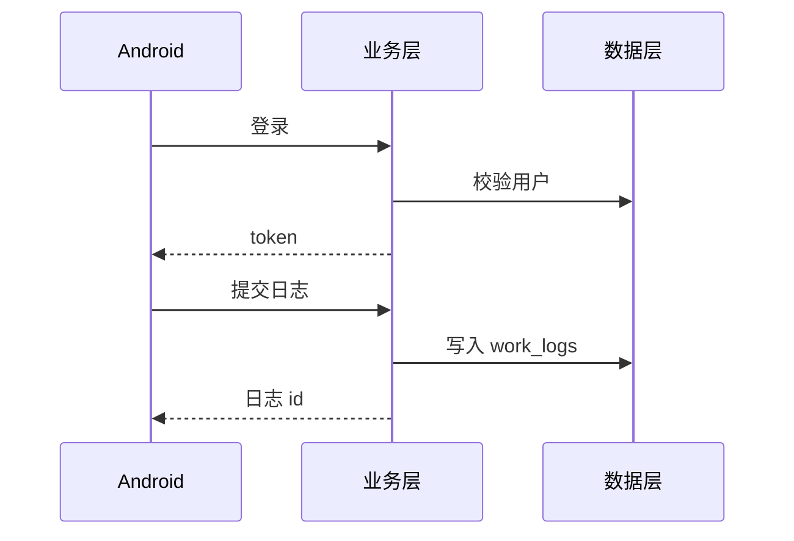

# 潘多拉 · 智能掌上工作系统

产品需求与设计文档  
Version: 0.5

当前运行范围见 [MVP验收](MVP验收.md)，本周核对见 [甲方对照与本周任务](甲方对照与本周任务-2026-10-15.md)。表结构完整规划与已实现范围分开阅读；公司事项发布角色尚待老师确认。

章节对齐课程模板《产品需求与设计文档》。模板正文里的外卖示例不采用。飞书周报与项目管理模板需登录后填写，仓库内保留同步稿。

## 1. 版本说明

| 更新时间 | 更新人 | 更新内容简介 |
|----------|--------|----------------|
| 2026-09-18 | 项目组 | 初始版本：按甲方 PDF 整理背景、目标、故事与表结构草案 |
| 2026-09-18 | 项目组 | 按课程文档模板重排；纠正面板只读/可编辑规则，补邀约请示与非功能分类 |
| 2026-09-18 | 项目组 | 写定技术选型、服务器、CI/CD 和开发前不能再改的运行约定 |
| 2026-09-24 | 项目组 | 与 Sprint 0 汇报 PPT 对齐：课程两项非功能改为安全性 + 可靠性；分工见团队分工.md |
| 2026-10-09 | 项目组 | Web 仅 ADMIN；App 四级 STAFF/TEAM_LEAD/DEPT_HEAD/FOUNDER；取消 Web 看下属日志 |

### 首个 MVP 记录（2026-10-08，历史）

这是项目内部讨论确定的当前实现增量，尚未作为全组或老师的最终范围结论：Android 登录、草稿/提交/作者修改、首页今日日志、按日查看、当时的Web授权查看与刷新同步（现已转为App业务查看）、本地启动和数据持久化。Android APK 已构建，真机验收待完成，见 [MVP验收](MVP验收.md)。下文完整甲方需求继续保留，任务、完整周月视图及其他面板业务等不因本轮完成而标记完成。

## 2. 产品概述

### 2.1 项目背景与意义

公司内部的任务和日志传递滞后。领导看不到每个人当天在做什么，员工也不清楚上级派下来的指令和自己的工作路径。潘多拉要做的是一套工作信息收发系统：用日志收集基础信息，用指令完成派发，用面板和月/周/日视图把信息摆出来，让管理人员能看到全员基础工作，员工能回溯自己的记录。

课程要求同时交付 Android 员工端和 Web 管理端。甲方材料把产品分成阶段，第一阶段只做信息汇集，不要把后面的分析做成现在的主路径。

### 2.2 项目目标

1. **日志汇集。** 完成日志的编辑、填写、整理和收集，作为全系统的信息入口。
2. **指令闭环。** 领导可以派发，也可以接收下级的邀约请示。一条任务包含名称、优先级、完成情况、时间节点、进度说明、责任人；日志里的任务还要能写详情和关联人。
3. **展示。** 登录后首页四个板块，加上由日志和关联派发生成的月视图、周视图、日视图。管理者能看到每个人的日志和全公司任务。
4. **管理后台。** Web 仅系统管理员：账号与组织授权；业务查看与穿透在 App。分层复核、跨公司匹配、AI 地图不放进第一阶段。

### 当前任务增量（2026-10-15）

Android领导向实际下级派发，责任人选择“待开始/进行中/已完成”并填写说明，上级App刷新查看。仅保留工作状态和进度说明，不输入或展示百分比；状态独立存储，进度说明最多2000字；只有责任人能反馈。截止时间用选择器填写，日历支持月/周/日。首页派发仍为授权范围最新十条，重要性排序尚未实现。Web仅ADMIN账号管理，不办理业务。当前任务表为dispatch_tasks；下文tasks为完整规划，关联人和请示尚未实现。

### 2.3 非功能性需求

课程验收至少提交两项非功能证据，与 Sprint 0 汇报一致，选定：**安全性**、**可靠性**（下表标注「课程两项」）。其他约束按后续范围推进，不占用这两项名额。

| 类别 | 要求 | 怎么验 |
|------|------|--------|
| 安全性（课程两项） | 业务接口必须登录；员工不能改公司事项，也不能改他人任务或日志；上级按穿透规则查看下属 | 无 token 返回 401，越权返回 403；密码只存哈希；保留权限用例与响应记录 |
| 可靠性（课程两项） | 已保存数据在服务或应用重启后仍可查询；保存失败须明确提示并保留用户输入 | 重启后按账号复查日志；失败场景录屏或用例记录 |
| 性能 | 常规数据量下，首页四板块和当日日志列表在进入页面后数秒内可看 | Sprint 3 用固定数据集计时，不在 Sprint 0 虚报指标 |
| 运营 | 公司事项正式内容集中维护，具体发布角色待老师确认；ADMIN目前仅账号管理 | 核对ADMIN不能访问业务，四级业务账号按范围读写 |
| 使用帮助 | 必填缺失、保存失败、空列表给出可理解的提示和处理方式 | 缺内容和断网保存各看一次界面文案 |
| 易用与风格 | 信息短、层级清楚；视觉走清晰、卡通、轻松，不堆装饰 | 对照低保真验收，详细视觉在原型里定 |

面板数据在进入页面或下拉刷新时更新。第一阶段不做长连接推送。

### 2.4 范围

**第一阶段要做**

- 日志录入、编辑、按日列表；由真实保存接口进行登录和内容校验
- 首页四板块，规则见 4.2
- 月 / 周 / 日视图
- 任务派发、接收、进度；上级可向下看，下级可向上邀约请示
- Web：仅系统管理员（`ADMIN`）使用，创建账号、改角色、设上级、停用；公司事项发布待与老师确认，本周不做
- App：员工 / 团队长 / 部门老总 / 创始人写日志与穿透查看；无公开自助注册
- 个人中心只管理自己的资料。甲方用「人人网个人面板」作比喻，指的是只看自己，不是做社交

**第一阶段不做**

- 按关键词数量和重要程度做数据地图，以及据此导出的工作清单
- 接入分析能力，结合 MBTI 给职业建议。用户可先选类型，再做在线评测、出报告。这是参考意见，不是管理结论
- 第二阶段才出现的「按业务找其他公司」
- 管理员修改后的分层复核。甲方写了，但同时要求第一阶段不要做复杂

甲方幻灯片里还提到自媒体、学生、电商、个体经营者。第一阶段用户仍是一家公司里的管理员、领导和员工。更宽的使用者放到后面的「其他公司板块」，避免范围失控。

### 2.5 角色

对齐甲方 PDF 第 6 页。Web 只给 `ADMIN`；App 走四级业务链。

| 角色 | 端 | 第一阶段能力 | 实现 |
|------|----|----------------|------|
| 系统管理员 | Web | 建用户、改角色 / `manager_id`、软停用；公司事项发布角色待确认 | `ADMIN` |
| 创始人 | App | 基础功能；可查公司业务用户日志；向上邀约不适用 | `FOUNDER` |
| 部门老总 | App | 基础功能；向下看子树；向上邀约请示 | `DEPT_HEAD` |
| 团队长 | App | 基础功能；向下看子树；向上邀约请示 | `TEAM_LEAD` |
| 员工 | App | 只看和改自己的面板与日志 | `STAFF` |

组织链：`STAFF → TEAM_LEAD → DEPT_HEAD → FOUNDER`（`manager_id`）。日志穿透：本人始终可见；`TEAM_LEAD` / `DEPT_HEAD` 可查向下子树；`FOUNDER` 可查业务用户；停用账号不能登录。

### 2.6 参照

| 参照 | 我们取什么 | 不取什么 |
|------|------------|----------|
| 番茄计划一类日历 | 月、周、日怎么排工作 | 不做番茄计时 |
| 甲方线框里的「奥菲斯」 | 信息要更快更清楚 | 没有更多说明，不单独立项 |
| 企业 IM / 审批 | — | 不做通用审批流 |
| 人人网 | 个人只看自己的面板 | 不做好友和动态 |

## 3. 概要设计

### 3.1 系统架构设计

表现层、业务层、数据层。Sprint 1 用一个后端进程，不拆微服务。当前以本地可运行演示为目标；云端和自动部署留待后续，不作为本周前置条件。



当前本地H2持久化；MySQL和HTTPS为后续部署选项，未作本轮运行验证。

#### 技术选型

| 项 | 决定 |
|----|------|
| 后端 | Spring Boot 3，Java 17 |
| 数据库 | 本地H2（MySQL模式）；另留MySQL配置。业务日期时区Asia/Shanghai |
| 表结构变更 | Flyway。第一张表就是迁移脚本，禁止连上库手工改表 |
| 登录 | JWT。密码只存 BCrypt 哈希 |
| Android | Kotlin，Jetpack Compose，最低 Android 8。包名 `com.projectpandora.app` |
| Web | Vue 3、Vite，当前未引入Element Plus |
| 接口前缀 | `https://<域名>/api/v1`。域名未买也可以，代码里不能写死 IP |
| 运行 | 后端和 MySQL 用同一份 Docker Compose。本地和服务器只换环境变量 |

不引入 Redis、对象存储、微服务。头像不做，个人资料只改显示名。

#### 服务器

当前使用本地电脑演示。后续需要公网访问时，再确定云主机、费用和域名。

机器上用 Caddy 或 Nginx：`/` 给 Web，`/api/` 反代到后端。Web 和接口同一域名，避免浏览器跨域。MySQL 不对公网开放。日志打到标准输出，由 Docker 收集。提供 `GET /api/v1/health`，部署后用它确认服务起来了。

#### CI/CD

用 GitHub Actions，不换别的系统。

- Pull Request 指向 `main` 时：跑后端测试和 Web 构建。测试使用内存数据库或测试容器，不连接云上的 MySQL。
- 合并进 `main` 后：用仓库 Secrets 里的 SSH 密钥登录服务器，执行 `docker compose up -d`，再请求健康检查。服务器还没有时，这一步先不接地址。
- Android 打包先不作为合并前置条件。
- 「必须通过 CI 才能合并」等 workflow 真正跑绿一次再打开。现在就勾会把仓库锁死。
- 密钥、数据库密码不进 Git。仓库只提交 `.env.example`。

Android 发给别人安装的包走 HTTPS。系统默认禁止明文 HTTP。仅本地调试可以放行 HTTP。

### 3.2 系统功能模块设计

```
掌握个人与团队工作
├── 账号与组织
│     ├── 登录（无公开注册）
│     ├── ADMIN 用户管理
│     └── 个人资料
├── 日志
│     ├── 新建与编辑
│     ├── 自己的列表
│     ├── App 上级穿透查看
├── 任务
│     ├── 派发与接收
│     ├── 进度
│     └── 向上邀约请示
├── 导图四板块
├── 月周视图
└── Web 管理（仅 ADMIN）
```

| 模块 | 职责 |
|------|------|
| 账号 | 登录发 token；五角色；ADMIN 建用户 / 改角色 / 停用 |
| 日志 | 按日保存；App 按穿透规则查询；保存时进行真实鉴权和输入校验 |
| 任务 | 派发、接收、改进度；保存名称、优先级、完成情况、时间节点、进度说明、责任人、详情、关联人 |
| 面板 | 拼出四板块；上面两块的正式内容只有管理员或派发逻辑能改 |
| 视图 | 用个人日志和关联派发填充日、周、月 |
| Web | 仅ADMIN账号与组织管理；公司事项维护端及角色待老师确认 |

当前底部导航：总览、日志、视图、我的。未完成的任务请示和开发预览不出现在普通用户入口。

### 3.3 数据库设计

以下是完整需求的表结构草案；已运行表以Flyway迁移为准，未实现的表不能作为已交付功能。实体：用户、日志、任务、公司事项、个人十大事、面板备注。任务的「关联人」先用 `tasks.related_user_ids` 文本保存，人多了再拆表。

表 3-1 用户 `users`

| 字段名 | 类型 | 是否为空 | 是否主键 | 字段说明 |
|--------|------|----------|----------|----------|
| id | BIGINT | 否 | 是 | 自增主键 |
| username | VARCHAR(64) | 否 | 否 | 登录名，唯一 |
| password_hash | VARCHAR(255) | 否 | 否 | 密码哈希 |
| role | VARCHAR(32) | 否 | 否 | ADMIN / FOUNDER / DEPT_HEAD / TEAM_LEAD / STAFF |
| disabled | BOOLEAN | 否 | 否 | 软停用；true 不可登录 |
| display_name | VARCHAR(64) | 是 | 否 | 显示名 |
| created_at | DATETIME | 否 | 否 | 创建时间 |

表 3-2 工作日志 `work_logs`

| 字段名 | 类型 | 是否为空 | 是否主键 | 字段说明 |
|--------|------|----------|----------|----------|
| id | BIGINT | 否 | 是 | 自增主键 |
| user_id | BIGINT | 否 | 否 | 作者 |
| log_date | DATE | 否 | 否 | 所属日期 |
| content | TEXT | 否 | 否 | 正文 |
| status | VARCHAR(16) | 否 | 否 | draft / submitted |
| created_at | DATETIME | 否 | 否 | 创建时间 |
| updated_at | DATETIME | 否 | 否 | 更新时间 |

表 3-3 任务 `tasks`

| 字段名 | 类型 | 是否为空 | 是否主键 | 字段说明 |
|--------|------|----------|----------|----------|
| id | BIGINT | 否 | 是 | 自增主键 |
| title | VARCHAR(128) | 否 | 否 | 名称 |
| detail | TEXT | 是 | 否 | 详情 |
| priority | VARCHAR(16) | 否 | 否 | 优先级 |
| status | VARCHAR(16) | 否 | 否 | 完成情况：todo / doing / done |
| due_at | DATETIME | 是 | 否 | 时间节点 |
| progress | INT | 是 | 否 | 旧接口兼容字段，新App不填写或展示；status独立存储 |
| progress_note | VARCHAR(500) | 是 | 否 | 进度说明 |
| assignee_id | BIGINT | 否 | 否 | 责任人 |
| creator_id | BIGINT | 否 | 否 | 派发人 |
| related_user_ids | VARCHAR(255) | 是 | 否 | 关联人 id，逗号分隔 |
| source | VARCHAR(16) | 否 | 否 | dispatch 派发 / invite 邀约 |

表 3-4 公司事项 `company_items`

| 字段名 | 类型 | 是否为空 | 是否主键 | 字段说明 |
|--------|------|----------|----------|----------|
| id | BIGINT | 否 | 是 | 自增主键 |
| item_type | VARCHAR(16) | 否 | 否 | important 公司大事 / dispatch 派发展示 |
| title | VARCHAR(128) | 否 | 否 | 标题 |
| sort_order | INT | 否 | 否 | 1–10，条形列表顺序 |
| detail | TEXT | 是 | 否 | 详情 |

表 3-5 个人十大事 `personal_top_items`

| 字段名 | 类型 | 是否为空 | 是否主键 | 字段说明 |
|--------|------|----------|----------|----------|
| id | BIGINT | 否 | 是 | 自增主键 |
| user_id | BIGINT | 否 | 否 | 所属用户 |
| title | VARCHAR(128) | 否 | 否 | 标题 |
| sort_order | INT | 否 | 否 | 1–10 |
| source_log_id | BIGINT | 是 | 否 | 来源日志，可空 |

表 3-6 个人备注 `panel_remarks`

| 字段名 | 类型 | 是否为空 | 是否主键 | 字段说明 |
|--------|------|----------|----------|----------|
| id | BIGINT | 否 | 是 | 自增主键 |
| user_id | BIGINT | 否 | 否 | 备注作者 |
| target_type | VARCHAR(32) | 否 | 否 | 指向哪一类面板项 |
| target_id | BIGINT | 否 | 否 | 指向的记录 |
| note | VARCHAR(500) | 否 | 否 | 备注正文 |

ER 图见 `docs/原型/er.md`。已实现表结构以Flyway为准；新增表按相应变更提交。

## 4. 详细设计与实现

类图在 Spring Boot 工程建起来之后再画。下面只写 Sprint 0 必须有的流程、时序和界面。

### 4.1 日志

员工登录后可直接新建或修改自己的日志（含已提交日志）；修改已提交日志后保留提交状态和原 ID，有读权限的上级App刷新显示最新内容。内容为空不能保存。保存成功后，当日列表、右下日志流和日视图都能看到这条记录。

上级只能读下级日志。员工不能读别人的。



界面：日志页是列表加编辑。空列表写「今天还没有日志」。提交成功显示保存结果，失败保留输入并说明重试方式。

### 4.2 导图四板块

| 位置 | 内容 | 谁能改正式内容 | 其他人 |
|------|------|----------------|--------|
| 左上 | 公司 10 大重要事项，条形，最多 10 条 | 集中维护，发布角色待确认 | 只读，可点进详情，可写个人备注 |
| 右上 | 公司 10 大派发，来自上级指令 | 派发逻辑写入，不在这里手改 | 只读，可写个人备注 |
| 左下 | 个人 10 大，由自己的日志汇总生成 | 本人可改内容和顺序 | — |
| 右下 | 当天日志流 | 本人进入日志页修改 | — |

上面两块不能被员工改掉公司原文。下面两块点进去就可以改自己的内容。

### 4.3 任务与邀约

领导创建任务并指定责任人。责任人看到详情后更新进度和说明。创建人看到完成情况。其他人改这条任务会被拒绝。

邀约是反向的一条任务：员工或下级填写请示，上级收到后决定是否转成正式派发。第一阶段只保证「发出、被看见、状态可改」，不做多级审批。

任务接收页上的完成率表、占比饼图、柱状图放到视图稳定之后再做，避免第一阶段过重。

### 4.4 视图

日视图列出当天日志和关联到自己的任务。周视图聚合 7 天。月视图在有内容的日期上做标记。数据只来自日志和派发，不单独再填一套日历。

### 4.5 账号与 Web

Android 与 Web 共用 `POST /auth/login`。未登录访问业务接口返回 401。公开自助注册关闭；账号由 `ADMIN` 在 Web 创建。公司事项发布角色尚待老师确认，本周不实现。下属日志由领导在 **App** 按穿透规则查看，不走 Web。

低保真见 `docs/原型/`。需覆盖：导图四宫格、日志页、日/周/月、Web 用户管理。

## 5. 用户故事

优先级和工作量以 `docs/backlog.md` 为准。P0 进第一阶段，P2 不做。

### 账号

| ID | 用户故事 | 优先级 | 验收标准 |
|----|----------|--------|----------|
| US-A1 | 作为业务用户，我可以使用管理员创建的账号登录 | P0 | 正确口令进入首页；错误口令有提示且没有 token |
| US-A2 | 作为管理员，我可以分配角色 | P0 | 角色、上级和停用状态持久化，不能借变更越权 |
| US-A3 | 作为用户，我可以改自己的显示名 | P1 | 保存后「我的」里能看到 |
| US-A4 | 作为未登录用户，我不能看业务数据 | P0 | 直接调接口得到 401 |

### 日志

| ID | 用户故事 | 优先级 | 验收标准 |
|----|----------|--------|----------|
| US-B1 | 作为员工，我可以新建当日工作日志 | P0 | 正文为空被拒绝；保存后列表可见 |
| US-B2 | 作为员工，我可以修改自己的日志（含已提交） | P0 | 本人可改；已提交修改后保持同 ID 和提交状态；其他员工改同一条被拒绝 |
| US-B3 | 作为员工，我可以按日看自己的日志 | P0 | 只返回自己的，新的在前 |
| US-B4 | 作为上级，我可以看下级日志 | P0 | 下级可见；同级员工互不可见 |

### 任务

| ID | 用户故事 | 优先级 | 验收标准 |
|----|----------|--------|----------|
| US-C1 | 作为领导，我可以创建任务并指定责任人 | P0 | 保存名称、优先级、时间节点、责任人 |
| US-C2 | 作为责任人，我可以查看任务详情 | P0 | 能看到进度、详情、关联人 |
| US-C3 | 作为责任人，我可以选择工作状态、填写进度说明 | P0 | 创建人刷新后看到新进度 |
| US-C4 | 作为领导，我可以查看完成情况 | P0 | 列表有状态和进度 |
| US-C5 | 作为无关用户，我不能改这条任务 | P0 | 得到 403 |
| US-C6 | 作为下级，我可以向上级发起邀约请示 | P1 | 上级能在列表里看到这条请示 |

### 面板、视图、Web

| ID | 用户故事 | 优先级 | 验收标准 |
|----|----------|--------|----------|
| US-D1 | 作为用户，登录后能看到四板块 | P0 | 位置与 4.2 一致 |
| US-D2 | 作为公司事项维护者，我可以编辑公司 10 大事 | P0 | 原稿要求；具体维护角色待老师确认，本周不做 |
| US-D3 | 作为领导，派发出去的任务出现在右上 | P0 | 与任务记录一致，最多展示 10 条 |
| US-D4 | 作为员工，我可以改自己的个人 10 大 | P1 | 初始来自日志汇总，改完以手改为准 |
| US-D5 | 作为用户，我可以给上面两块加个人备注 | P1 | 备注只影响自己，不改公司原文 |
| US-E1 | 作为员工，我可以看日视图 | P0 | 当天日志和任务都在 |
| US-E2 | 作为员工，我可以看周视图 | P1 | 覆盖该周 7 天 |
| US-E3 | 作为员工，我可以看月视图 | P1 | 有内容的日期有标记 |
| US-F1 | 作为管理员，我可以在 Web 登录 | P0 | 仅 ADMIN |
| US-F2 | 公司事项维护入口 | P0 | 端与发布角色待老师确认，本周暂缓 |
| US-F3 | 作为管理员，我可以在 Web 建用户、改角色、设上级、停用 | P0 | 非 ADMIN 403 |

以上故事形成闭环：「员工 App 登录 → 写日志 → 领导 App 按穿透可见；管理员 Web 管账号」。
